<a href="https://teddy-bertrand.vercel.app/"><picture><source media="(prefers-color-scheme: dark)" srcset="assets/hero-dark.svg"></picture></a>

<a href="https://teddy-bertrand.vercel.app/"><picture><source media="(prefers-color-scheme: dark)" srcset="assets/button-portfolio-dark.svg"></picture></a>
<a href="https://teddy-bertrand.vercel.app/cv/teddy-bertrand-cv.pdf"><picture><source media="(prefers-color-scheme: dark)" srcset="assets/button-cv-dark.svg"></picture></a>
<a href="https://www.linkedin.com/in/teddy-bertrand-b22446357/"><picture><source media="(prefers-color-scheme: dark)" srcset="assets/button-linkedin-dark.svg"></picture></a>
<a href="mailto:teddy.bertrand@epitech.eu"><picture><source media="(prefers-color-scheme: dark)" srcset="assets/button-email-dark.svg"></picture></a>

Third-year software engineering student at Epitech, 2024–2029.

**Open to a 4-month internship, March–June 2027.** Montpellier or remote.

### Building

- **[Mayfly](https://github.com/TeddyBertrand/Mayfly)**: runs each GitHub Actions job in a fresh Docker container, destroyed when the job ends. `Go` `Terraform` `Prometheus`
- **[Smart Claude Router](https://github.com/TeddyBertrand/Smart-Claude-Router)**: streaming proxy that sends easy Claude Code requests to cheaper models. `Rust` `Axum` `Ollama`
- **[VitaeBuild](https://teddy-bertrand.vercel.app/projects/vitaebuild)**: turns a YAML or JSON resume into PNG, SVG or text, with its own layout engine. `Rust` `egui`

Previously: full-stack intern at CDC Habitat (Next.js, TypeScript, PostgreSQL).
